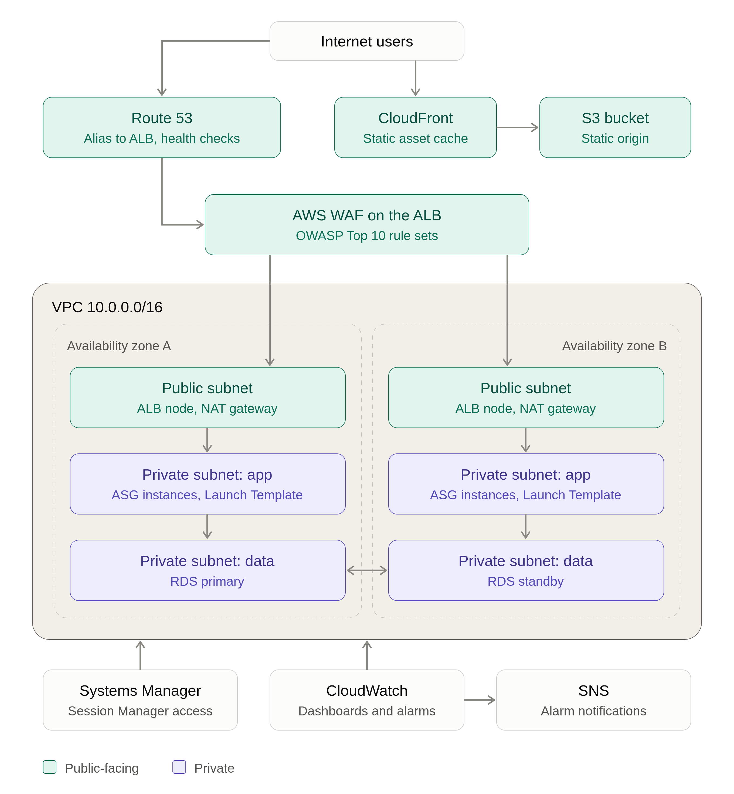

# Scalable Web Application with ALB and Auto Scaling

A hands-on AWS project that builds and demonstrates a PHP web application behind an Application Load Balancer, with EC2 Auto Scaling, a VPC split into public/private subnets, a database, and operational/security services.

> **Status based on repository evidence:** screenshots document AWS resources and a working application/phpMyAdmin view: VPC networking, two NAT gateways, private subnet routing, security groups, a PHP AMI/Launch Template, an Auto Scaling group, an ALB, RDS, WAF, CloudWatch alarms, and SNS topics. One EC2 instance screenshot shows a public IPv4 address; it is not clear whether that instance is a temporary setup host or an application node. Confirm the ASG subnet placement before describing compute as private. Screenshots do not prove resources still exist or every configuration is production-ready. See [Implementation status](#implementation-status).

## What this project demonstrates

- Network isolation with public and private subnets and NAT egress.
- Reusable EC2 configuration through a custom AMI and Launch Template.
- Load balancing and Auto Scaling for a PHP application.
- Relational database connectivity from the application tier.
- Administrative access through AWS Systems Manager in the documented instance setup.
- Web application firewall and basic monitoring/notification resources.

## Key AWS Services

The list below covers the services used in the project and the intended architecture. Some items still need live-console verification; CloudFront and Route 53 are not yet evidenced in the repository, and Multi-AZ failover and specific WAF rule behavior have not been demonstrated.

- **VPC:** Public and private subnets, NAT gateways, security groups, and network ACLs (NACLs)
- **EC2 + Auto Scaling Group (ASG):** Launch Template and scaling policies, including target tracking
- **ALB + AWS WAF:** Layer 7 routing and WAF rules intended to help protect against common web application risks, including OWASP Top 10 categories
- **CloudFront:** Intended for caching static assets and reducing latency; implementation still needs confirmation
- **RDS Multi-AZ:** MySQL/PostgreSQL with automated failover; the current evidence shows an RDS MySQL instance, but Multi-AZ failover is unverified
- **Route 53:** Intended alias record pointing to the ALB and health checks; implementation still needs confirmation
- **Systems Manager:** Session Manager for secure instance access without relying on public SSH
- **CloudWatch + SNS:** Monitoring dashboards, alarms, and notifications; delivery should be tested in the live environment

## Learning Outcomes

Through this project, I worked on the following AWS concepts and skills:

- Design VPCs with suitable subnet, route table, and NAT gateway configurations
- Build highly available architectures across multiple Availability Zones
- Configure ALB listener rules and target group health checks
- Set up Auto Scaling with target tracking and step scaling policies
- Secure applications with WAF, security groups, and private subnets
- Use Systems Manager Session Manager as a bastion-free alternative for instance access

## Solution architecture

the solution diagram using lucidcharts

## Request flow

1. A user opens the application endpoint shown in the project evidence.
2. The ALB receives the request and forwards it to a healthy application target.
3. An EC2 instance runs the PHP/Apache application. The instance configuration is based on a custom AMI and Launch Template.
4. The application connects to the RDS MySQL database.
5. Private instances use NAT for outbound access where configured. NAT gateways are shown in both AZs; exact route associations should be confirmed in the live account.
6. AWS WAF, CloudWatch alarm actions, and SNS notification delivery should be reviewed in the AWS console before claiming the full behavior is validated.

## Implementation status

| Component | Evidence in repository |
|---|---|
| VPC and subnet layout | [VPC screenshot](Screenshots/Productionvpc.png), NAT and route screenshots |
| NAT gateways | [Two NAT gateways screenshot](Screenshots/two-natgtws-one-in-each-az.png) |
| Private-subnet routing | [Private route table screenshot](Screenshots/route-to-natgtw-from-php-app-private-subnet.png) |
| Security groups | [Security groups screenshot](Screenshots/Security-groups.png) |
| PHP app / Apache | [Working app screenshot](Screenshots/LTami-instance-working.png) and [phpMyAdmin screenshot](Screenshots/php-app-lb-working.png) |
| AMI and Launch Template | [AMI](Screenshots/php-app-ami.png), [Launch Template](Screenshots/php-app-LT.png), [instance setup](Screenshots/config-LTami-instance.png) |
| Systems Manager | [SSM role screenshot](Screenshots/php-app-LT-ssm-connection-role.png) |
| Auto Scaling | [ASG screenshot](Screenshots/ASG.png) |
| Load balancing | [ALB screenshot](Screenshots/ALB.png), [application through the load balancer](Screenshots/php-app-lb-working%282%29.png) |
| Database | [RDS subnet group](Screenshots/db-subnet-group.png), [RDS instance](Screenshots/php-mysql-db.png) |
| AWS WAF | [WAF screenshot](Screenshots/waf-ALB.png) |
| CloudWatch and SNS | [Alarms](Screenshots/cloudwatch-alarms.png), [topics](Screenshots/sns-topics.png) |
| CloudFront and s3 | No screenshot evidence found |
| IRoute 53 and ALB | No IaC files found |

