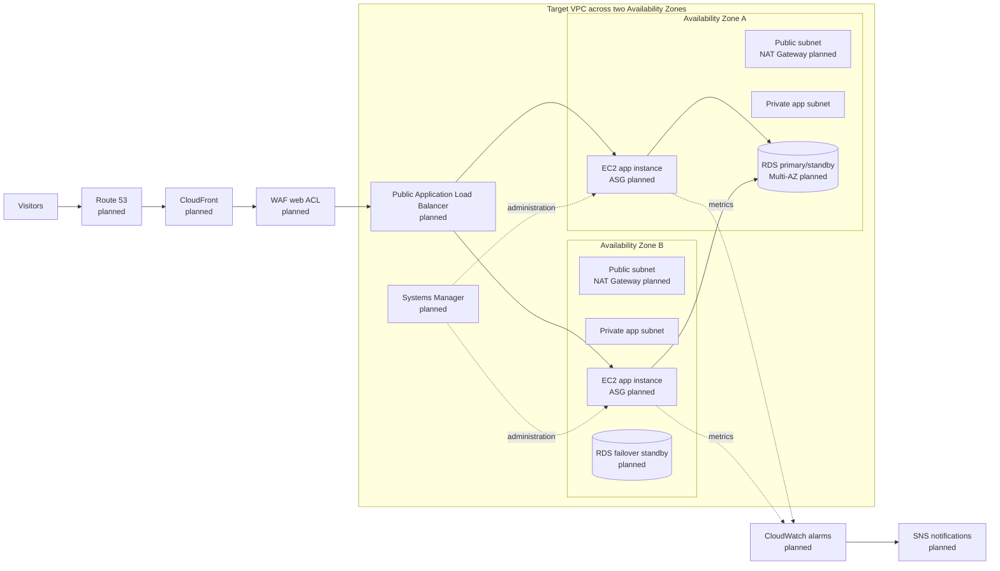

# Scalable Web Application with ALB and Auto Scaling

> **Portfolio project status: early implementation / architecture in progress.** The repository currently documents manual Amazon Linux 2023 setup for Apache, PHP, and phpMyAdmin. It does not yet contain infrastructure-as-code, application source, or evidence that the full high-availability architecture has been deployed. Services shown in the target diagram are **planned**, unless explicitly marked implemented below.

A learning project for designing a secure, highly available web application on AWS. The intended end state places an EC2 Auto Scaling group in private subnets across two Availability Zones, behind an Application Load Balancer, with CloudFront for static content and a Multi-AZ relational database.

## At a glance

- **Implemented evidence:** manual Apache/PHP/phpMyAdmin setup notes in the README history/current instructions.
- **Target architecture:** VPC, public/private subnets across two AZs, ALB, EC2 Auto Scaling, CloudFront, Multi-AZ RDS, Route 53, WAF, Systems Manager, CloudWatch, and SNS.
- **Deployment status:** no reproducible deployment scripts or AWS resource definitions are currently included.
- **Audience:** learners and reviewers looking for a clear roadmap from a single-instance web-server setup to a production-style AWS design.

## Solution architecture

The diagram represents the **planned target state**, not a claim that these resources are currently provisioned. The source is [docs/architecture.mmd](docs/architecture.mmd).



## Architecture and service plan

| Layer | Intended service/design | Status in this repository |
|---|---|---|
| Network | VPC, two public and two private subnets across two AZs, route tables, NAT gateways, security groups, NACLs | Planned; no VPC definitions present |
| Edge and DNS | Route 53 alias and health checks; CloudFront for static assets; AWS WAF managed protections | Planned |
| Traffic | ALB HTTPS listener, target group health checks, routing rules | Planned |
| Compute | EC2 Launch Template and Auto Scaling group in private subnets; target tracking and step scaling | Planned |
| Application | Apache + PHP; phpMyAdmin setup notes | Setup documented; no application source or automated bootstrap currently present |
| Database | RDS MySQL or PostgreSQL, Multi-AZ, backups and failover | Planned; no database provisioning/configuration present |
| Operations | Systems Manager Session Manager; CloudWatch dashboard/alarms; SNS notifications | Planned |
| Delivery | Reproducible infrastructure and deployment process | Planned; no IaC or deployment automation present |

See [docs/architecture.md](docs/architecture.md) for design details and [docs/security.md](docs/security.md) for intended security controls.

## Request flow

1. A visitor resolves the application hostname through Route 53.
2. CloudFront serves cacheable static assets and forwards dynamic requests to the ALB. (Both are target components.)
3. AWS WAF evaluates HTTP(S) requests before they reach the application.
4. The ALB health-checks and distributes requests to healthy EC2 instances in private subnets across the two AZs.
5. Application instances access the database through a restricted database security-group rule.
6. CloudWatch alarms publish notifications through SNS.

This flow is a design description; it is not currently deployed by repository code.

## Current implementation

The only implementation evidence currently available is a README command sequence for manually installing Apache, PHP and phpMyAdmin on an EC2 host and editing phpMyAdmin configuration to reference a database endpoint. It is not an end-to-end deployment guide, and the repository does not establish that a database, ALB, ASG, VPC, or other target services exist.

**Important:** the original notes include destructive/unsafe-for-sharing shell commands and a manual phpMyAdmin configuration step. Treat them as historical setup notes; do not use them as a production installation script. A future implementation should use reviewed, repeatable user data or configuration management and keep secrets out of source control.

## Deployment roadmap

No one-command deployment is available yet. The intended implementation sequence is:

1. Define the VPC, AZ-spread public/private subnets, route tables, and NAT egress.
2. Add security groups with least-privilege traffic paths.
3. Add the EC2 Launch Template and private-subnet Auto Scaling group.
4. Add the ALB, HTTPS listener, target group health checks, and scaling policies.
5. Add a Multi-AZ RDS database and application configuration via secure parameter/secret storage.
6. Add Route 53, CloudFront, and WAF configuration.
7. Add Systems Manager access, CloudWatch dashboard/alarms, and SNS notifications.
8. Document prerequisites and deploy/rollback commands alongside the chosen IaC tool.

For the detailed target workflow and validation checklist, see [docs/deployment.md](docs/deployment.md).

## Validation checklist

Before calling the architecture complete, document and verify:

- Both AZs contain the expected public and private subnets and correct routes.
- Application instances have no direct public ingress and pass Systems Manager managed-node checks.
- ALB target health checks pass and traffic reaches only healthy targets.
- Auto Scaling responds to the selected metric and restores desired capacity after a test.
- The application can connect to RDS without exposing the database publicly.
- RDS Multi-AZ failover behavior and backup settings are understood.
- WAF is associated with the intended entry point and logging is configured.
- CloudFront caches only intended static paths and dynamic paths reach the origin.
- CloudWatch alarms transition as expected and SNS delivery is confirmed.

These are planned acceptance checks, not completed test results. Operational notes are in [docs/operations.md](docs/operations.md).

## Repository layout

```text
.
├── README.md
└── docs/
    ├── architecture.md
    ├── architecture.mmd
    ├── deployment.md
    ├── operations.md
    └── security.md
```

## Cost and cleanup awareness

This target design can incur ongoing charges, especially for NAT gateways, ALB, EC2, RDS Multi-AZ, CloudFront, WAF, and data transfer. Use a dedicated learning account, set a budget alert, choose small test sizes, and avoid leaving resources running. Follow [docs/deployment.md](docs/deployment.md#cleanup) for a cleanup checklist once deployment automation exists. Verify resource deletion and retained snapshots manually; deleting resources may not remove backups or logs.

## Contributing and learning

Issues and pull requests are welcome. Please distinguish verified implementation from proposed design, include reproducible steps for changes, and never commit credentials, private keys, database passwords, or account-specific identifiers.

## License

No license file is currently present. Unless a license is added, reuse and redistribution permissions are not explicitly granted.
