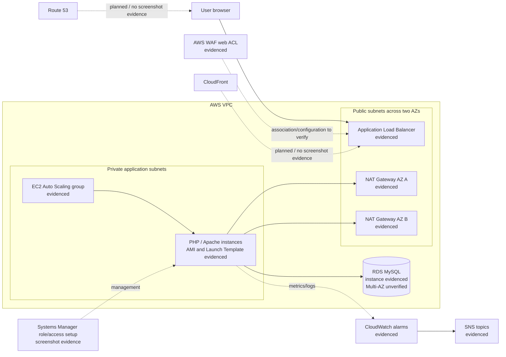

# Scalable Web Application with ALB and Auto Scaling

A hands-on AWS project that builds and demonstrates a PHP web application behind an Application Load Balancer, with EC2 Auto Scaling, a VPC split into public/private subnets, a database, and operational/security services.

> **Status based on repository evidence:** screenshots document AWS resources and a working application/phpMyAdmin view: VPC networking, two NAT gateways, private subnet routing, security groups, a PHP AMI/Launch Template, an Auto Scaling group, an ALB, RDS, WAF, CloudWatch alarms, and SNS topics. One EC2 instance screenshot shows a public IPv4 address; it is not clear whether that instance is a temporary setup host or an application node. Confirm the ASG subnet placement before describing compute as private. Screenshots do not prove resources still exist or every configuration is production-ready. See [implementation status](#implementation-status).

## What this project demonstrates

- Network isolation with public and private subnets and NAT egress.
- Reusable EC2 configuration through a custom AMI and Launch Template.
- Load balancing and Auto Scaling for a PHP application.
- Relational database connectivity from the application tier.
- Administrative access through AWS Systems Manager in the documented instance setup.
- Web application firewall and basic monitoring/notification resources.

## Solution architecture

The diagram below reflects the screenshot evidence and labels areas that still need verification. Editable source: [docs/architecture.mmd](docs/architecture.mmd).



## Request flow

1. A user opens the application endpoint shown in the project evidence.
2. The ALB receives the request and forwards it to a healthy application target.
3. An EC2 instance runs the PHP/Apache application. The instance configuration is based on a custom AMI and Launch Template.
4. The application connects to the RDS MySQL database.
5. Private instances use NAT for outbound access where configured. NAT gateways are shown in both AZs; exact route associations should be confirmed in the live account.
6. AWS WAF, CloudWatch alarm actions, and SNS notification delivery should be reviewed in the AWS console before claiming the full behavior is validated.

## Implementation status

| Component | Evidence in repository | Status / limits |
|---|---|---|
| VPC and subnet layout | [VPC screenshot](Screenshots/Productionvpc.png), NAT and route screenshots | Resources are visible; exact CIDRs and routes need live verification. One instance screenshot shows a public IPv4 address, so app-tier placement must be confirmed |
| NAT gateways | [Two NAT gateways screenshot](Screenshots/two-natgtws-one-in-each-az.png) | Two gateways are visible; current state and route usage can change |
| Private-subnet routing | [Private route table screenshot](Screenshots/route-to-natgtw-from-php-app-private-subnet.png) | Route to NAT is shown; full route table details should be checked live |
| Security groups | [Security groups screenshot](Screenshots/Security-groups.png) | Groups exist; rules are too small in the screenshot to certify least privilege |
| PHP app / Apache | [Working app screenshot](Screenshots/LTami-instance-working.png) and [phpMyAdmin screenshot](Screenshots/php-app-lb-working.png) | A web page and phpMyAdmin login page are shown working at capture time |
| AMI and Launch Template | [AMI](Screenshots/php-app-ami.png), [Launch Template](Screenshots/php-app-LT.png), [user data setup](Screenshots/config-LTami-instance.png) | Screenshots show these resources and setup; repeatability and current versions are unverified |
| Systems Manager | [SSM role screenshot](Screenshots/php-app-LT-ssm-connection-role.png) | Role/access configuration is shown; a successful Session Manager session is not independently proven by this image |
| Auto Scaling | [ASG screenshot](Screenshots/ASG.png) | Group is shown; scaling policy behavior and instance replacement tests are not documented |
| Load balancing | [ALB screenshot](Screenshots/ALB.png), [application via load balancer](Screenshots/php-app-lb-working%282%29.png) | ALB and application response are shown; target health and multi-instance distribution require live checks |
| Database | [RDS subnet group](Screenshots/db-subnet-group.png), [RDS instance](Screenshots/php-mysql-db.png) | Database and subnet group are shown; Multi-AZ failover, backup, encryption, and public-access settings are unverified |
| AWS WAF | [WAF screenshot](Screenshots/waf-ALB.png) | Web ACL is shown; association, rule coverage, and blocking tests should be checked live |
| CloudWatch and SNS | [Alarms](Screenshots/cloudwatch-alarms.png), [topics](Screenshots/sns-topics.png) | Alarms and topics exist in screenshots; alarm actions and confirmed delivery are not demonstrated |
| CloudFront and Route 53 | No screenshot evidence found | Planned / not yet documented as implemented |
| Infrastructure as code | No IaC files found | Not currently reproducible from this repository |

For the end-to-end walkthrough, go to [Step-by-step documentation](Steps_documentation.md). Supporting notes: [architecture](docs/architecture.md), [deployment](docs/deployment.md), [operations](docs/operations.md), and [security](docs/security.md).

## Repository structure

```text
.
├── README.md
├── Steps_documentation.md     # Screenshot-led project walkthrough
├── Screenshots/               # AWS console and application evidence
└── docs/
    ├── architecture.md
    ├── architecture.mmd       # Mermaid source for the architecture diagram
    ├── deployment.md
    ├── operations.md
    └── security.md
```

## Security notes

The screenshot set is not enough to certify production security. Before presenting this as production-ready, verify the actual security-group rules, database public-access and encryption settings, IAM policy scope, TLS configuration, WAF association/rules, secret handling, logging, and backup recovery. Do not add credentials or unredacted AWS account identifiers to screenshots or documentation. The historical phpMyAdmin setup notes should not be used as a production installation procedure.

## Deployment, validation, and cleanup

This repository records console-based implementation evidence but does not include infrastructure-as-code or a complete repeatable deployment script. Follow [docs/deployment.md](docs/deployment.md) for an implementation-aware checklist and cleanup order. Validate live health checks, scaling, database connectivity, WAF behavior, and SNS delivery before describing those behaviors as tested.

NAT gateways, EC2, ALB, RDS, WAF, CloudWatch, and data transfer can incur charges. Use a learning account and budget alert. Remove unused resources and review snapshots, logs, and elastic IPs after cleanup.

## License

No license file is currently present. Reuse and redistribution permissions are not specified.
