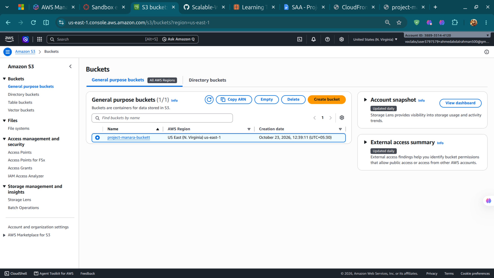
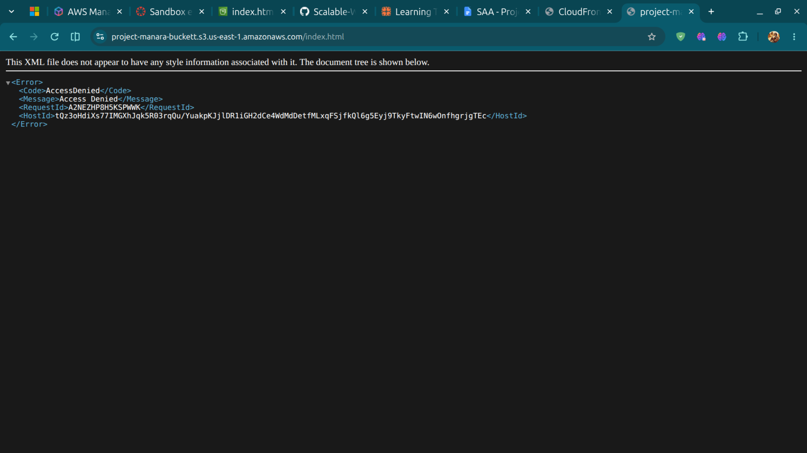
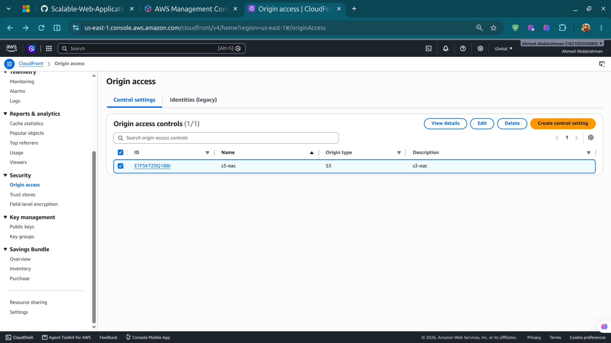
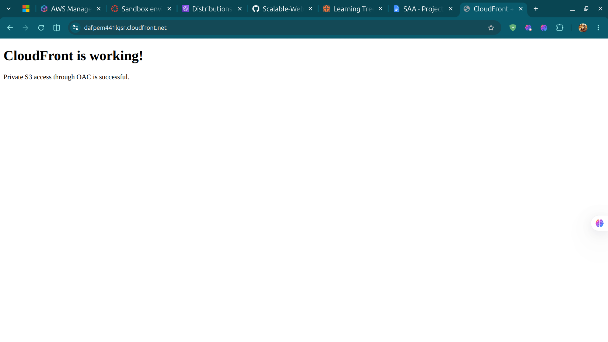
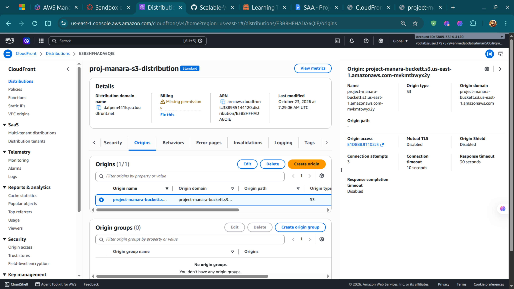
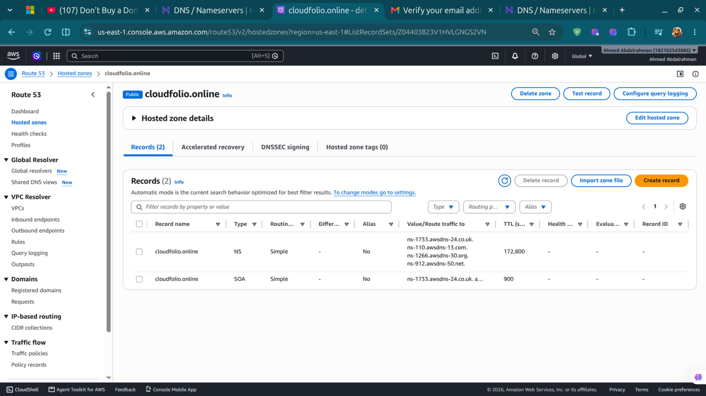
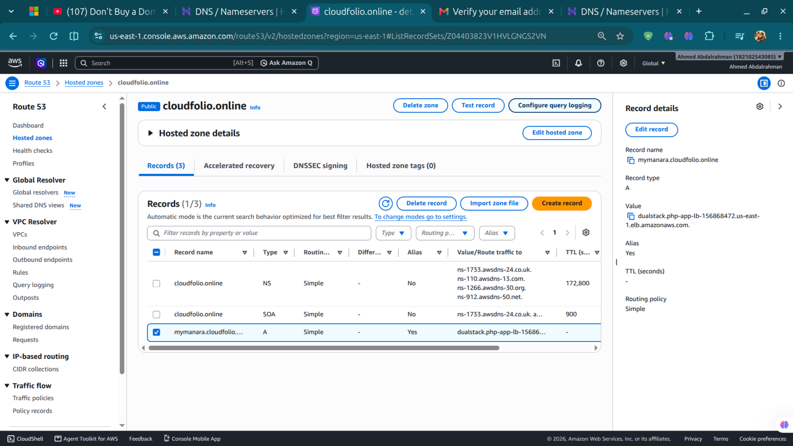
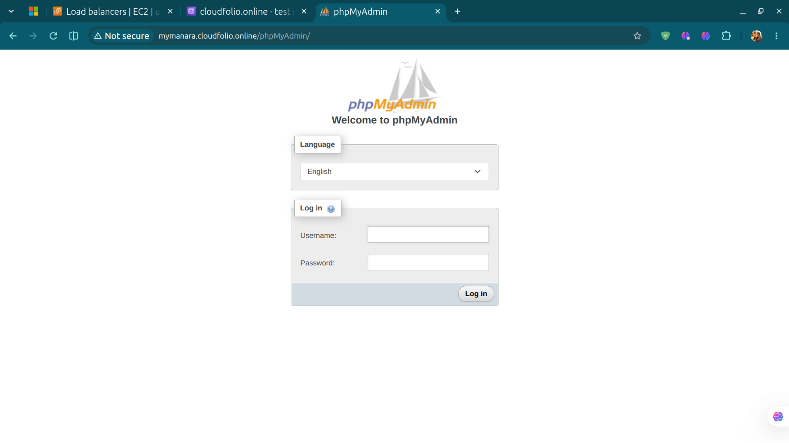

# How I Built the AWS Web Application

This document summarizes how I built the AWS web application. The screenshots in `Screenshots/` record key parts of the setup.

## Part 1: Setting up the network

### 1. Set up the VPC

I set up the VPC, subnets, and route tables as the network foundation for the application.

### 2. Set up NAT gateways

I set up two NAT gateways, one in each Availability Zone, to provide outbound internet access for resources in private subnets.

### 3. Set up the private subnet route

I configured the PHP application subnet's route table to route outbound traffic through the NAT gateway.

### 4. Set up the security groups

I created security groups to control traffic between the application, load balancer, and database tiers.

## Part 2: Preparing the application instances

### 5. Create the application AMI

I created a custom AMI as the base image for the PHP application instances.

### 6. Set up the EC2 instance

I set up the EC2 instance for application preparation, including its network access, security groups, and IAM role.

### 7. Install and configure the web server

I installed and configured Apache and PHP on the application instance to run the web application.

### 8. Configure the Launch Template settings

I configured the Launch Template settings, including the AMI, instance type, network settings, security groups, IAM profile, storage, and metadata options.

### 9. Create the Launch Template

I created a Launch Template to store the instance configuration used by the Auto Scaling group.

### 10. Set up Systems Manager access

I configured the role and access setup for AWS Systems Manager so I could manage the application instance through Session Manager.

## Part 3: Load balancing and scaling

### 11. Set up the Auto Scaling group

I created and configured the Auto Scaling group to launch and manage application instances using the Launch Template across the selected Availability Zones.

### 12. Set up the Application Load Balancer

I configured the Application Load Balancer as the entry point for application traffic, including its listeners, target group, health checks, subnets, and security group.

## Part 4: Connecting the database

### 13. Set up the DB subnet group

I configured the RDS DB subnet group with subnets in two Availability Zones.

### 14. Set up the MySQL database

I created the RDS MySQL database and configured its accessibility, availability settings, backups, encryption, maintenance settings, and security group.

### 15. Test the application through the ALB

After setting up the database, I tested the application through the load-balancer endpoint.

## Part 5: Security and monitoring

### 16. Set up AWS WAF

I created and configured an AWS WAF web ACL for the project and associated it with the ALB.

### 17. Set up CloudWatch alarms

I created CloudWatch alarms to monitor the application and configured their metrics, thresholds, evaluation periods, and actions.

### 18. Set up SNS topics

I created SNS topics for project notifications and configured their connection to CloudWatch alarm actions and email subscriptions.

## Part 6: CloudFormation and S3

### 19. Deploy and verify the CloudFormation stack

CloudFormation can create and manage the AWS resources defined in a template as a stack. In the AWS CloudFormation console, review the template and parameters, create the stack, and monitor the **Events** tab until the stack reaches `CREATE_COMPLETE` or `UPDATE_COMPLETE`. If a deployment fails, inspect the failed event and its status reason before retrying.

**Evidence note:** This repository currently does not contain a CloudFormation template or a CloudFormation stack-status screenshot. Add the actual template and screenshot of the successful stack status here to document the specific deployment; no successful deployment is claimed by this text alone.

### 20. Create and verify the S3 bucket

I created an S3 bucket for the project's static content. The bucket screenshot records the bucket setup.

The repository also includes a screenshot of a private S3 bucket, which documents the private-bucket configuration.

### 21. Understand and troubleshoot S3 Access Denied

An **Access Denied** response means the request did not have the required permission, or an applicable policy or access-control setting denied it. For a private S3 origin behind CloudFront, check that the CloudFront distribution uses the intended Origin Access Control (OAC), that the bucket policy allows the correct CloudFront distribution to perform `s3:GetObject`, and that S3 Block Public Access remains enabled when public bucket access is not intended. Also confirm the object key exists and that the distribution's default root object is configured if the site is expected to open at the root URL.

**Evidence note:** The current repository tree does not contain a screenshot explicitly named for an S3 Access Denied error. Add that screenshot when available so the issue and its resolution can be demonstrated directly.

### 22. Configure CloudFront Origin Access Control

I configured Origin Access Control (OAC) for the CloudFront S3 origin so CloudFront could access bucket objects without making the bucket public.

### 23. Verify CloudFront is working

I used the CloudFront working screenshot as evidence that the distribution was responding as expected.

The distribution configuration is also recorded in the following screenshot.

## Part 7: Connecting the custom domain with Route 53

### 24. Create a public hosted zone in Route 53

### 25. Verify the Route 53 hosted-zone record

### Route 53 alias record working

