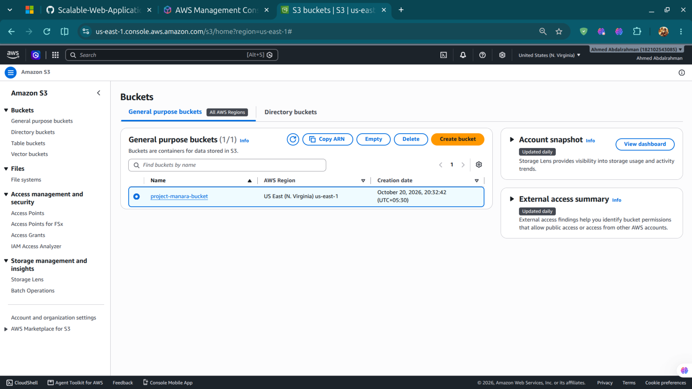

# How I Built the AWS Web Application

This document summarizes how I built the AWS web application. The screenshots in `Screenshots/` record key parts of the setup.

## Part 1: Setting up the network

### 1. Set up the VPC

I set up the VPC, subnets, and route tables as the network foundation for the application.

### 2. Set up NAT gateways

I set up two NAT gateways, one in each Availability Zone, to provide outbound internet access for resources in private subnets.

### 3. Set up the private subnet route

I configured the PHP application subnet's route table to route outbound traffic through the NAT gateway.

### 4. Set up the security groups

I created security groups to control traffic between the application, load balancer, and database tiers.

## Part 2: Preparing the application instances

### 5. Create the application AMI

I created a custom AMI as the base image for the PHP application instances.

### 6. Set up the EC2 instance

I set up the EC2 instance for application preparation, including its network access, security groups, and IAM role.

### 7. Install and configure the web server

I installed and configured Apache and PHP on the application instance to run the web application.

### 8. Configure the Launch Template settings

I configured the Launch Template settings, including the AMI, instance type, network settings, security groups, IAM profile, storage, and metadata options.

### 9. Create the Launch Template

I created a Launch Template to store the instance configuration used by the Auto Scaling group.

### 10. Set up Systems Manager access

I configured the role and access setup for AWS Systems Manager so I could manage the application instance through Session Manager.

## Part 3: Load balancing and scaling

### 11. Set up the Auto Scaling group

I created and configured the Auto Scaling group to launch and manage application instances using the Launch Template across the selected Availability Zones.

### 12. Set up the Application Load Balancer

I configured the Application Load Balancer as the entry point for application traffic, including its listeners, target group, health checks, subnets, and security group.

## Part 4: Connecting the database

### 13. Set up the DB subnet group

I configured the RDS DB subnet group with subnets in two Availability Zones.

### 14. Set up the MySQL database

I created the RDS MySQL database and configured its accessibility, availability settings, backups, encryption, maintenance settings, and security group.

### 15. Test the application through the ALB

After setting up the database, I tested the application through the load-balancer endpoint.

## Part 5: Security and monitoring

### 16. Set up AWS WAF

I created and configured an AWS WAF web ACL for the project and associated it with the ALB.

### 17. Set up CloudWatch alarms

I created CloudWatch alarms to monitor the application and configured their metrics, thresholds, evaluation periods, and actions.

### 18. Set up SNS topics

I created SNS topics for project notifications and configured their connection to CloudWatch alarm actions and email subscriptions.

## Part 6: Keeping the S3 bucket private and connecting CloudFront

### 19. Create the private S3 bucket

I created a private S3 bucket for static content and kept its objects from being publicly accessible.

### 20. Configure Origin Access Control (OAC) for CloudFront

I configured Origin Access Control for the CloudFront S3 origin so CloudFront could access bucket objects without making the bucket public.

## Part 7: Connecting the custom domain with Route 53

### 21. Create a public hosted zone in Route 53

1. Open the **Amazon Route 53** console and select **Hosted zones**.
2. Choose **Create hosted zone**.
3. Enter the registered domain name (for example, `cloudfolio.online`).
4. Select **Public hosted zone**, then create the hosted zone.
5. Open the hosted zone and note the four authoritative **NS** nameserver values. Route 53 also creates the default **SOA** record; keep both default records.

If a public hosted zone for the domain already exists, use that zone instead of creating a duplicate.

### 22. Delegate the domain to Route 53 at the registrar

1. Sign in to the domain registrar where the domain was purchased (for example, Hostinger).
2. Open the domain's **Nameservers** settings.
3. Choose the option to use custom nameservers and replace the registrar's current nameservers with the **four NS values shown in the Route 53 hosted zone**.
4. Save the change. Do not enter the ALB DNS name in the nameserver fields; the ALB DNS name belongs in a Route 53 record.
5. Allow time for DNS delegation and resolver caches to update.

The registrar's nameservers must match the NS records for the Route 53 hosted zone. Otherwise, public DNS queries may not reach the records created in Route 53.

### 23. Create an A Alias record pointing to the Application Load Balancer

1. In Route 53, open **Hosted zones** and select the public hosted zone for the domain.
2. Choose **Create record**.
3. For **Record name**, enter the desired subdomain prefix. For example, enter `mymanara` to create `mymanara.cloudfolio.online`. To use the zone apex (the root domain itself), leave the record name blank.
4. Set **Record type** to **A**.
5. Enable **Alias**.
6. For **Route traffic to**, select **Alias to Application and Classic Load Balancer**.
7. Select the AWS Region where the ALB was created (for this project, `us-east-1`), then choose the correct Application Load Balancer.
8. Keep **Routing policy** as **Simple**, then choose **Create records**.

For this project, the ALB DNS name is `dualstack.php-app-lb-156868472.us-east-1.elb.amazonaws.com`. Prefer selecting the ALB from the Route 53 target list so AWS fills in the correct target automatically. The alias record should target the ALB, not an individual EC2 instance or a fixed IP address.

### 24. Verify DNS and test the domain

1. Confirm the new record appears in the hosted zone with type **A** and **Alias = Yes**.
2. Confirm the domain registrar is using the same four Route 53 nameservers shown in the hosted zone.
3. After DNS propagation, open the custom domain in a browser and check that the application responds.
4. If the domain returns `ERR_NAME_NOT_RESOLVED`, verify nameserver delegation first, then confirm the record name and hosted zone. Also verify that the ALB is active and its target group reports healthy targets.

**HTTPS note:** An A Alias record only routes DNS traffic; it does not enable HTTPS by itself. To serve HTTPS on the custom domain, request or import an ACM certificate for the exact hostname in **US East (N. Virginia), `us-east-1`, when using an ALB in that Region**. Validate the certificate, add an HTTPS (443) listener to the ALB using that certificate, and ensure the ALB security group allows inbound TCP 443. Keep an HTTP (80) listener only if you want to redirect HTTP requests to HTTPS.

**CloudFront note:** Use an alias to the ALB for a hostname intended to reach the dynamic PHP application through the ALB. If a hostname is intended to serve the CloudFront distribution instead, create its Route 53 alias to CloudFront and configure that hostname as an alternate domain name on the distribution. A single hostname should not be configured to point to both the ALB and CloudFront for this simple setup.
