# How I Built the AWS Web Application

This file walks through the main steps I followed for the project, using the screenshots in the \`Screenshots/\` folder as a record of the setup. The screenshots show what was on screen when I captured them, so I still recommend checking the live AWS console before assuming a resource is running or a setting is unchanged.

## Part 1: Setting up the network

### 1. Review the VPC layout

I started by checking the VPC and how its subnets and routing were arranged. This is the foundation for the rest of the setup, because the load balancer, application instances, and database all depend on the network being configured correctly.

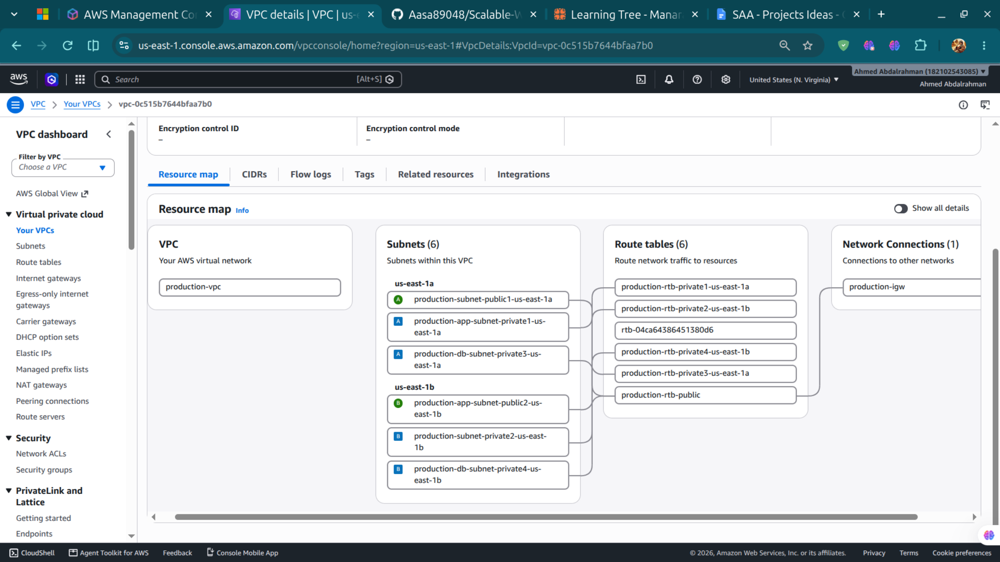

When reviewing this step in AWS, check the subnet CIDRs, Availability Zones, and route table associations in the console rather than relying on the screenshot for exact values.

### 2. Set up NAT gateways

The project screenshot shows two NAT gateways, one in each Availability Zone. They are intended to let resources in private subnets make outbound connections without giving those instances a direct route from the internet.

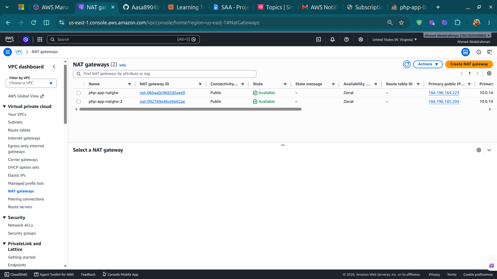

Make sure both gateways are available and that each private subnet routes outbound traffic through the intended NAT gateway. NAT gateways can continue to incur charges while they exist.

### 3. Check the private subnet route

I checked the route table used by the PHP application subnet to see how outbound traffic reaches the NAT gateway.

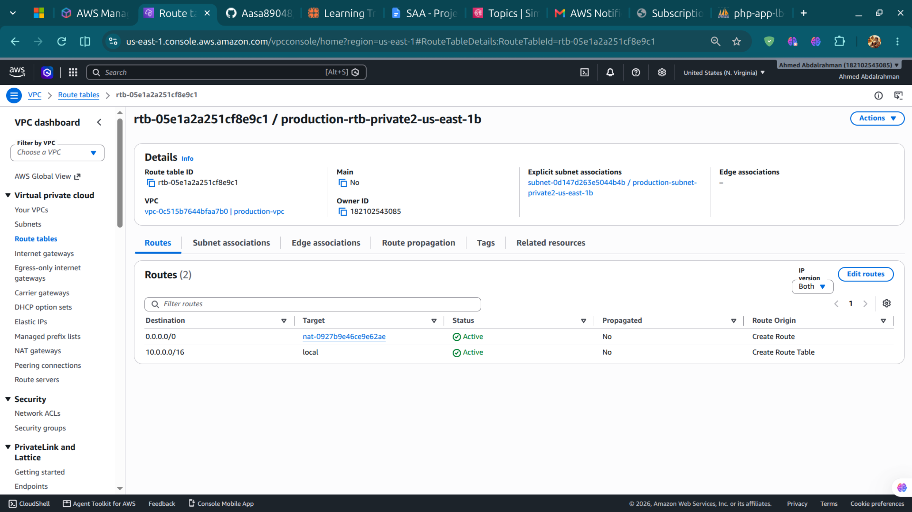

The route table should include the local VPC route and the expected default route to NAT. The application subnet should not have an unintended direct route to an internet gateway.

### 4. Review the security groups

This screenshot records the security groups created for the project.

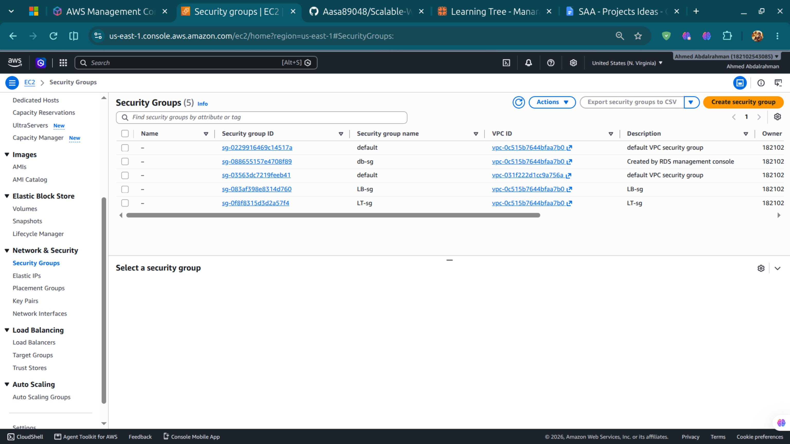

Open each security group in AWS and check the actual inbound and outbound rules. The screenshot is not clear enough to confirm every port or source range. As a general rule, the application should accept web traffic from the load balancer, and the database should accept connections only from the application tier.

## Part 2: Preparing the application instances

### 5. Create the application AMI

I created a custom AMI to use as the starting image for the PHP application instances.

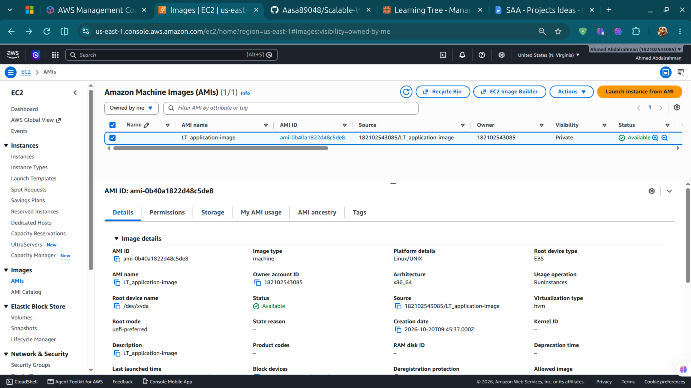

Before using the image in a new deployment, confirm it is available in the correct AWS Region and contains the packages the app needs. It should not contain credentials, temporary files, or other sensitive information.

### 6. Install and configure the web server

The setup screenshot records the instance configuration, including the web server setup. The project notes refer to Apache and PHP, with phpMyAdmin used for database administration.

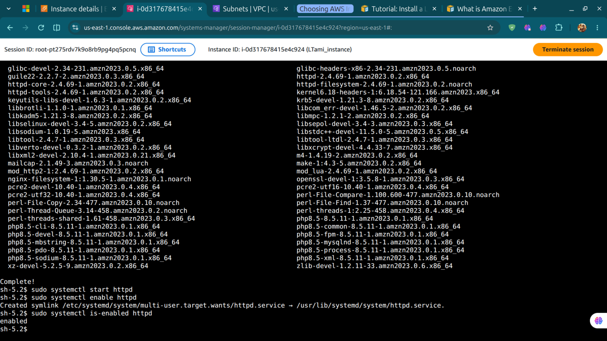

For a repeatable deployment, I would keep the setup steps in a reviewed bootstrap script or configuration-management process. Passwords and other secrets should not be placed directly in user data.

### 7. Check the EC2 instance

This screenshot shows an EC2 instance used during application setup.

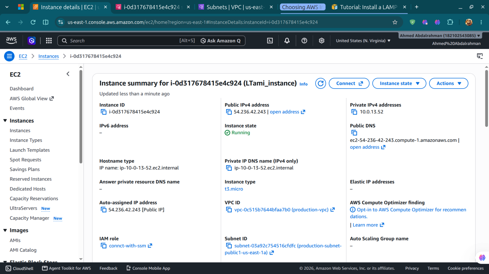

One thing worth checking here is the public IPv4 address shown in the screenshot. Confirm whether this was only a temporary instance used to prepare the AMI or whether it belongs to the running application tier. For the intended private-subnet design, application instances should normally receive traffic through the ALB, with inbound access restricted accordingly. Also check the attached security groups and IAM role.

### 8. Create the Launch Template

The Launch Template stores the instance settings that the Auto Scaling group uses when launching application servers.

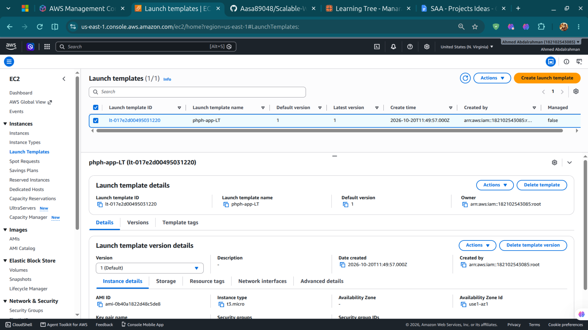

### 9. Review the Launch Template settings

This screenshot shows the Launch Template details and version information.

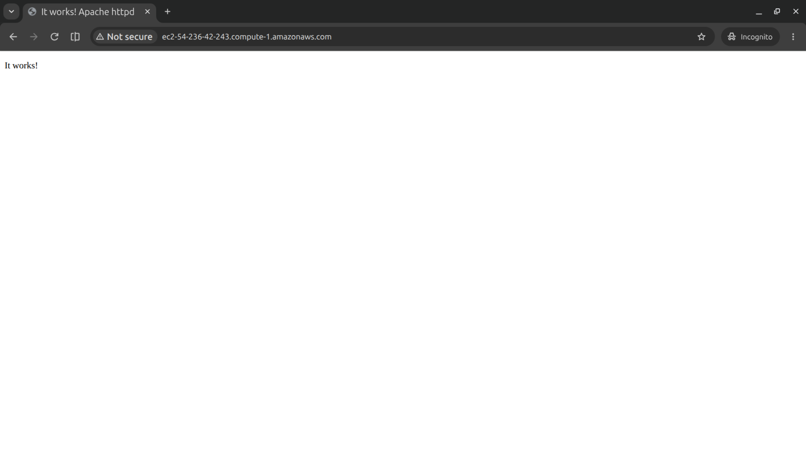

Before using a template version, check its AMI, instance type, subnet/network settings, security groups, IAM instance profile, storage encryption, and metadata options. The screenshot is a reference, not proof that every setting is correct.

### 10. Configure Systems Manager access

I also recorded the role and configuration used for Systems Manager access to the application instance.

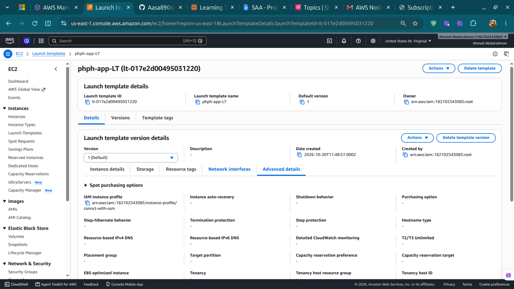

Check that the instance appears as a managed node and that Session Manager can open a session. This is preferable to leaving SSH open to the internet. Review the role permissions and keep them limited to what the instance actually needs.

## Part 3: Load balancing and scaling

### 11. Review the Auto Scaling group

The Auto Scaling group uses the Launch Template to create and manage application instances.

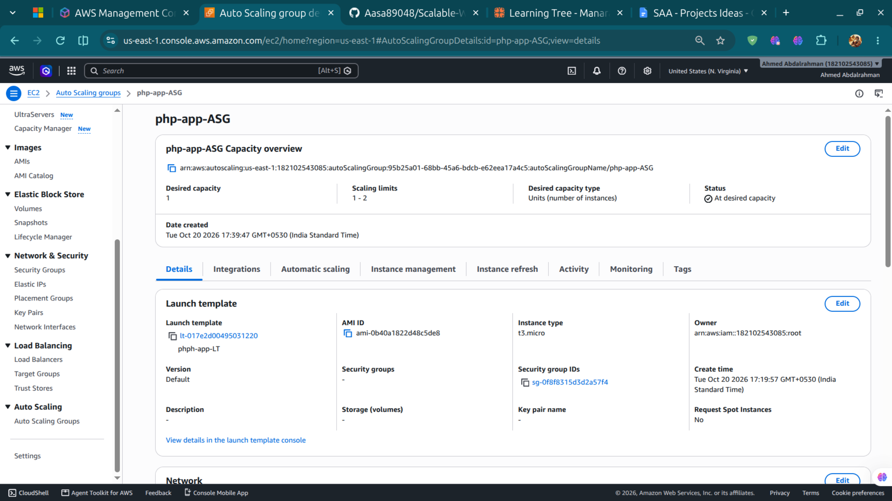

Check the minimum, desired, and maximum capacity, the subnets selected across Availability Zones, the health-check settings, and the target group attachment. Also review the scaling policy. This screenshot shows the group configuration, but it does not by itself demonstrate that scaling has been triggered successfully.

### 12. Review the Application Load Balancer

The ALB is the entry point for requests going to the application.

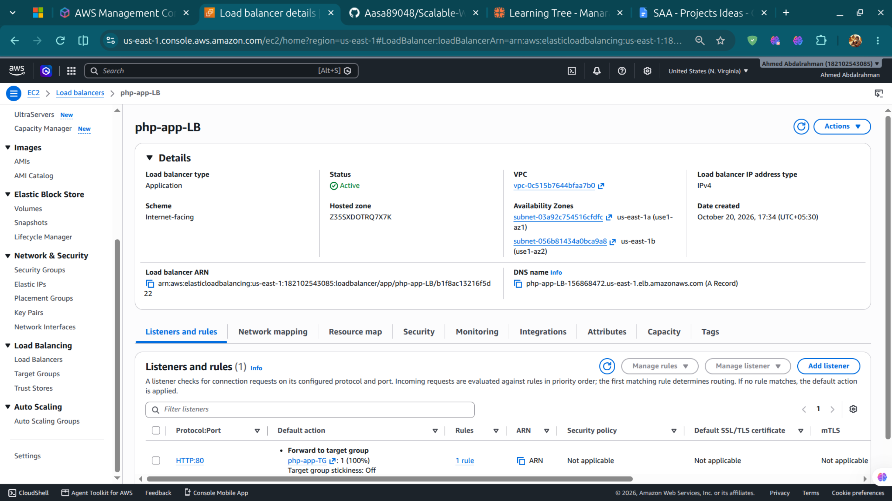

Check the listeners, certificate if HTTPS is configured, target group, health-check path and port, selected subnets, and security group. Before testing the application, make sure the registered targets are healthy.

### 13. Open the application on the instance

This screenshot shows the web application responding from the EC2 setup.

Use this as a basic check that the web server is serving a page. It does not confirm that requests are going through the load balancer.

### 14. Test the application through the ALB

The next screenshot records the PHP application responding through the load-balancer endpoint.

To check the load-balancing behavior properly, send several requests and confirm that healthy targets are registered. If the page displays an instance identifier, use it to check whether requests reach different instances. A single screenshot is not enough to prove traffic distribution or failover.

## Part 4: Connecting the database

### 15. Set up the DB subnet group

The RDS subnet group screenshot shows subnets in two Availability Zones.

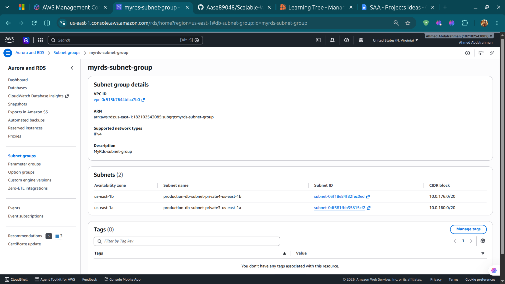

Confirm that the subnet group belongs to the intended VPC and uses private subnets in at least two AZs. Check the route tables as well; the subnet group alone does not guarantee that the database is private.

### 16. Review the MySQL database

This screenshot records the RDS MySQL database instance used by the project.

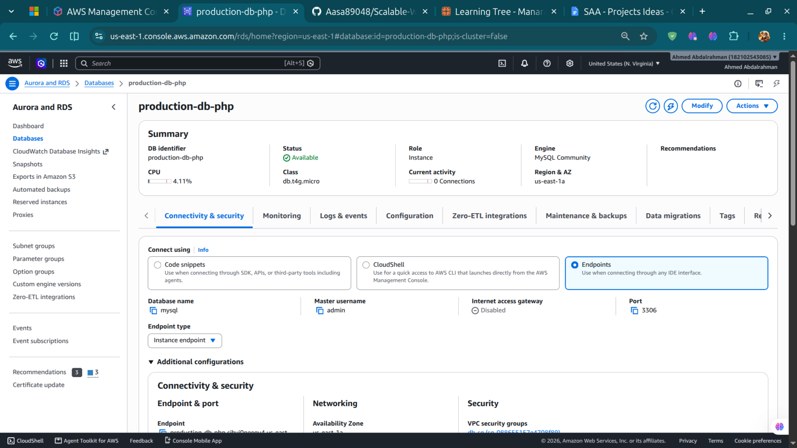

In the live console, review public accessibility, Multi-AZ configuration, backups, encryption, maintenance settings, and the database security group. The screenshot does not demonstrate a Multi-AZ failover test.

### 17. Check database access through phpMyAdmin

The project includes a phpMyAdmin view for database administration.

Use the running application to confirm that it is connecting to the intended RDS endpoint and that the displayed database content is coming from that instance. The screenshot alone cannot confirm where the endpoint or credentials are configured. Keep database secrets out of the repository, screenshots, and user data; a proper deployment should store secrets securely rather than relying on manual settings.

## Part 5: Security and monitoring

### 18. Review AWS WAF

The WAF screenshot records a web ACL associated with the project setup.

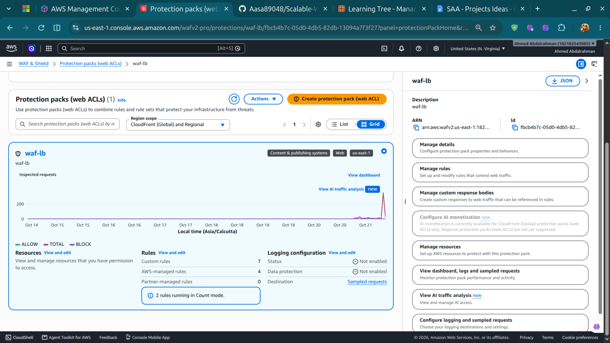

Confirm that the web ACL is associated with the intended ALB, then review the enabled rules and any scope-down settings. If you want to claim that WAF blocks particular requests, test that behavior safely and keep evidence of the result. Creating a web ACL alone does not prove that a particular class of attack is blocked.

### 19. Check the CloudWatch alarms

This screenshot shows the CloudWatch alarms created for the project.

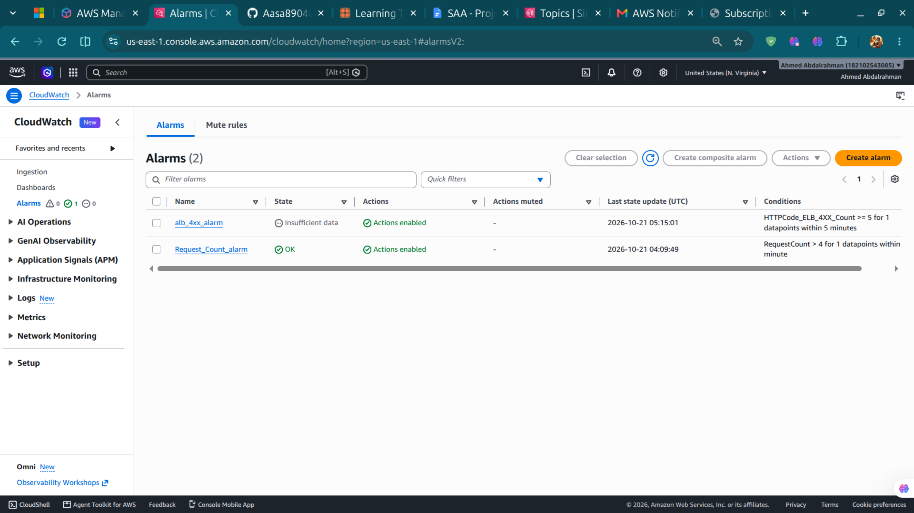

For each alarm, check its metric, threshold, evaluation period, current state, and configured action. Where practical, trigger a safe test condition and confirm that the alarm changes state as expected.

### 20. Check the SNS topics

The SNS console screenshot records the topics used for notifications.

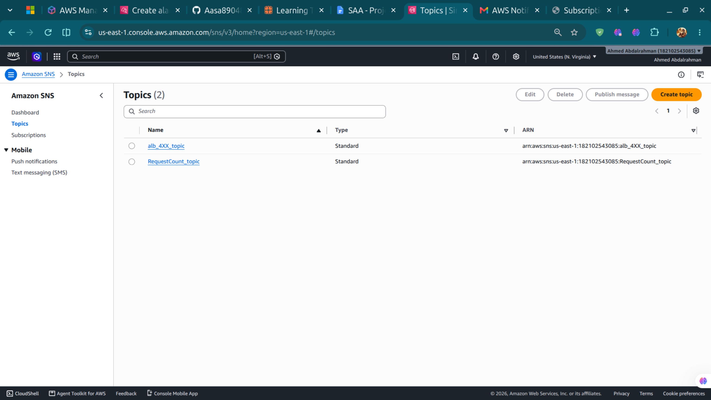

Make sure the CloudWatch alarm actions point to the correct topic and that the intended email subscriptions have been confirmed. The presence of a topic does not prove that a notification was delivered, so test delivery before documenting it as working.

### 21. Review the phpMyAdmin endpoint

This screenshot shows the phpMyAdmin login page at the project endpoint.

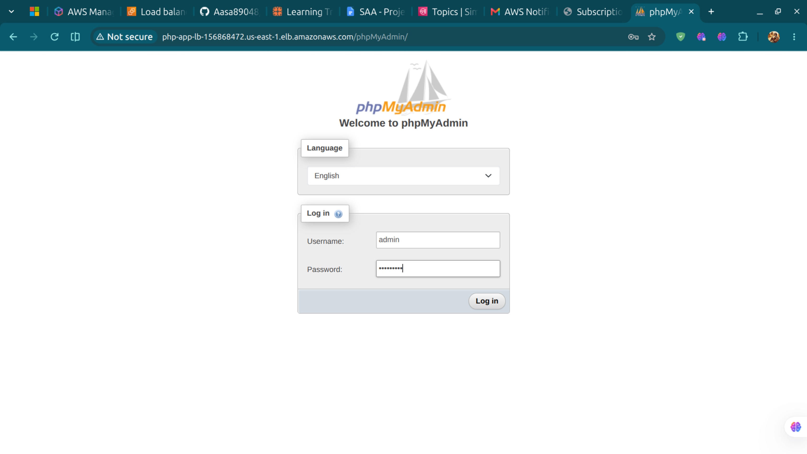

Keep credentials out of the documentation and avoid exposing administrative tools unnecessarily. For a portfolio project, consider restricting access to phpMyAdmin rather than leaving it publicly reachable.

## What still needs a separate test

The screenshots in this repository are useful records of the setup, but they do not confirm every behavior in the live environment. In particular, I have not included screenshot evidence here that proves:

- CloudFront or Route 53 is configured.
- The Auto Scaling group has scaled out or replaced an unhealthy instance.
- The RDS database has completed a Multi-AZ failover.
- SNS notifications have been delivered successfully.
- The WAF has blocked a test request.
- Every application instance is running in a private subnet.

Before describing any of these as completed, check the relevant AWS console settings and run the test. Also review the resources after testing and remove anything no longer needed, since EC2, ALB, RDS, NAT gateways, WAF, and related services can incur charges.
